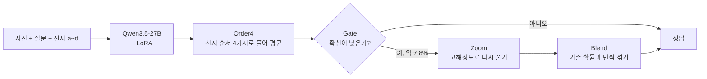

# SignVQA

> 간판·메뉴판·표지판 사진을 보고 4지선다 질문에 답하는 VLM 실험.<br/>
> **한 번에 하나만 바꾸고, 통계 검정을 통과한 변화만 개선으로 인정했습니다.**

    

<sub>SSAFY AI Challenge 2 · 팀 프로젝트 중 개인 실험 라인 · 2026.09 ~ 10</sub>

<br/>

## 핵심 성과

| 지표 | 결과 | 비고 |
|---|---|---|
| **팀 최종 성적** | Kaggle Public **0.97497** · **217팀 중 21위** | 팀 성과 |
| 개인 최고 제출 | Kaggle Public **0.97140** | Qwen3.5-27B + LoRA + 팀 추론 기법 이식 |
| 개인 실험 개선 폭 | 0.94727 → **0.97140** | 첫 Kaggle 제출(E1) → 최종(E8) |
| 수행 실험 | **12단계** (A\~D, E1\~E8) | 모두 같은 문항에서 McNemar exact 검정 |

<br/>

## 주요 작업

- **공정한 비교 체계** — 분할을 CSV로 고정하고 ID 해시를 대조하며, 모든 노트북이 같은 프롬프트·파서 모듈([`src/common_eval.py`](src/common_eval.py))을 import합니다. 정확도 차이가 대응 표본 검정을 통과하지 못하면 "구분되지 않음"으로 기록합니다.
- **모델 크기와 학습 효과 검증** — 3B → 9B → 27B로 키울 때마다 올랐고(90.3% → 94.2% → 96.9%), 9B → 27B는 p = 0.0014로 유의했습니다. 9B에 QLoRA를 더하면 +1.93%p(p = 0.011)가 올랐습니다.
- **평가 기준 재설계** — 기존 검증 세트가 리더보드보다 1.2%p 높게 나오는 것을 발견했습니다. train 전체로 재면 리더보드와 0.16%p 차이임을 확인하고, 학습 5,414 / holdout 1,300으로 다시 나눴습니다.
- **추론 단계 기법 이식** — 팀이 만든 Order4·Gate·Zoom·Blend를 [`src/tta.py`](src/tta.py)로 다시 구현하고, 팀 결과와 1,343/1,343 같은 답이 나오는 것을 확인한 뒤 내 모델에 적용했습니다.
- **16 GiB GPU에서 27B 돌리기** — 4bit 양자화에 임베딩·lm_head만 CPU에서 계산해 최대 12.5 GiB로 맞췄습니다. 제출은 Colab vLLM(bf16)으로 6,714문항을 22분에 풀었습니다.

<br/>

## 최종 추론 파이프라인



## 실험 결과 요약

| 단계 | 바꾼 것 | 평가 세트 | 결과 | 판정 |
|---|---|---|---:|---|
| B | 이미지만 (Qwen2.5-VL-3B) | val 672 | 90.33% | 기준선 |
| C | + OCR 텍스트 | val 672 | 89.73% | 구분 안 됨 (p = 0.557), 비용 5.3배 → **OCR 제외** |
| E1 | 3B → Qwen3.5-9B | val 672 | 94.20% | Kaggle 0.94727 |
| E2·E3 | CoT, 선지 감추고 먼저 읽기 | val 672 | 95.09%·94.20% | 둘 다 구분 안 됨 |
| E4 | 9B → **27B** | val 672 | **96.88%** | p = 0.0014 · Kaggle 0.95710 |
| E7 | 27B + LoRA | holdout 1,300 | 96.54% | Kaggle 0.96425 |
| E8 | + Order4·Gate·Zoom·Blend | holdout 1,300 | **97.23%** | **Kaggle 0.97140** |

<sub>전체 표와 실험별 질문·결과·다음 결정은 [실험 기록](docs/experiment-story.md)에 있습니다.</sub>

<br/>

## 기술 스택

| 영역 | 사용 기술 |
|---|---|
| 모델 | Qwen3.5 VLM (4B · 9B · 27B), Qwen2.5-VL-3B, PaddleOCR-VL |
| 학습 | LoRA, QLoRA (PEFT), 4bit nf4 양자화 |
| 추론 | Transformers(로컬 RTX 5060 Ti), vLLM(Colab A100) |
| 분석 | pandas, scikit-learn, McNemar exact 검정 |
| 품질 | 단위 테스트 18건, 노트북 생성기 + 검증 스크립트 (GPU 불필요) |

<br/>

## 내 역할

팀 프로젝트에서 **개인 실험 라인(A\~D, E1\~E8) 전체를 설계하고 실행했습니다.**

- 가설 설정, 실험 설계, 학습·추론 코드, 평가 체계, 오답·데이터 분석을 직접 했습니다.
- 최종 단계의 Order4·Gate·Zoom·Blend는 **팀원이 만든 기법**이며, 저는 이를 다시 구현해 검증하고 제 모델에 옮겨 적용했습니다.
- 팀 최종 0.97497 · 21위는 팀 전체의 성과입니다.

<br/>

## 기술적 의사결정

### 1. OCR을 붙이면 좋아질 것 같았지만 → 데이터로 확인하고 버렸다

- **가설**: 글자가 많은 사진이니 OCR 텍스트를 함께 주면 정확도가 오를 것이다.
- **검증**: 이미지만 / OCR만 / 둘 다 / 둘 다 없음을 같은 672문항으로 비교했습니다. 이미지+OCR(89.73%)이 이미지만(90.33%)을 넘지 못했고(p = 0.557), 두 구성이 갈린 26문항에서 정답 문구가 OCR에 담긴 비율도 양쪽 27%로 같았습니다.
- **결정**: OCR과 VLM이 같은 곳에서 실패한다고 보고, 비용이 5.3배인 OCR을 빼고 모델 크기를 키우는 쪽으로 갔습니다. 이후 27B에서 처음으로 유의한 개선(p = 0.0014)이 나왔습니다.

### 2. 검증 점수가 리더보드보다 높다 → 평가 세트부터 다시 만들었다

- **문제**: 27B가 val 672에서 96.88%였지만 리더보드는 0.95710으로 1.17%p 낮았습니다. 672문항의 95% 신뢰구간이 ±1.3%p라, 앞으로 나올 1%p 안팎의 개선을 가려낼 수 없었습니다.
- **해결**: train 전체(6,714)로 돌려 리더보드와 0.16%p 차이임을 확인하고, 학습 5,414 / holdout 1,300으로 분할을 다시 고정했습니다.
- **결과**: 이후 단계마다 holdout과 리더보드가 같은 방향, 비슷한 크기로 움직였습니다(E7 → E8: holdout +0.69%p, LB +0.72%p).

### 3. "라벨 오류"처럼 보이던 문항 → 정답의 정의부터 확인했다

- **발견**: 정답은 사진 속 사실이 아니라 여러 교육생이 일치해서 고른 답이었습니다(멘토 설명). 오류처럼 보이던 문항 상당수가 사람의 해석 방식이었습니다.
- **검증**: "사람들이 고를 답을 고르라"는 지시문은 효과가 없었지만(p = 0.41), 학습은 효과가 있었습니다(+1.93%p, p = 0.011). 모델이 확신하는데 사람과 다른 35문항은 이미지를 직접 확인해 결함 13문항만 제외 후보로 남겼습니다.
- **배운 점**: 데이터를 기계적으로 거르면 배워야 할 신호까지 버리게 됩니다. 확신하는 불일치 중에도 모델이 틀린 경우가 있었습니다.

<br/>

## 실행 방법

> 대회 데이터·모델·실험 결과(`data/`, `downloads/`, `output/`)는 저장소에 없습니다. 코드·분할 ID·문서만 공개합니다.

```bash
pip install -r requirements.txt
python -m unittest discover -s tests -v                       # 테스트 (GPU·모델 불필요)
python scripts/run_nb.py notebooks/experiments/AI_Challenge2_expE4_qwen35_27b.ipynb   # 로컬 실험
python scripts/build_e7_colab_notebook.py A                    # Colab 노트북 생성
```

데이터 배치와 Colab 실행 절차는 [docs/setup.md](docs/setup.md)에 있습니다.

<br/>

## 더 보기

| 문서 | 내용 |
|---|---|
| [실험 기록](docs/experiment-story.md) | 실험 흐름 전체: 질문 → 결과 → 다음 결정 |
| [실험 상세](docs/experiments.md) | 실험별 설계·수치·검정, 오답 분류, 데이터 진단 |
| [의사결정 이력](docs/decisions.md) | 날짜별 진행과 선택의 근거 |
| [트러블슈팅](docs/troubleshooting.md) | 실제로 막힌 문제와 해결 |
