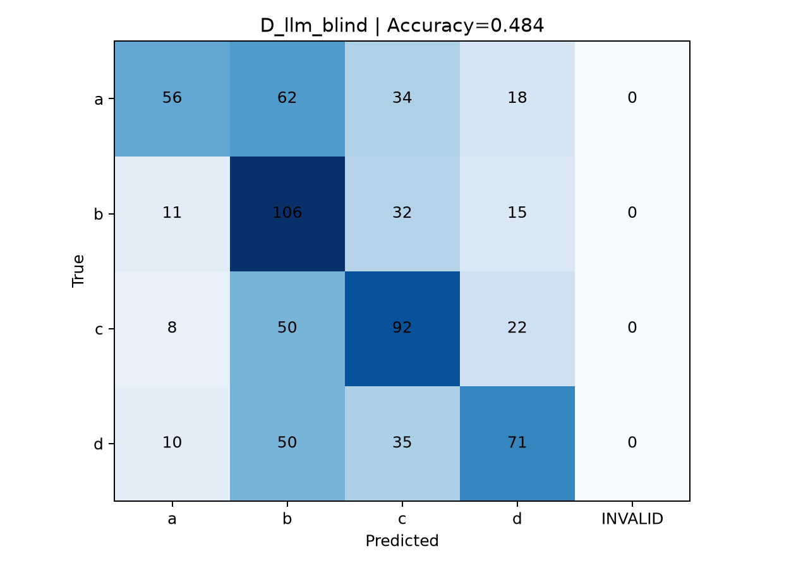
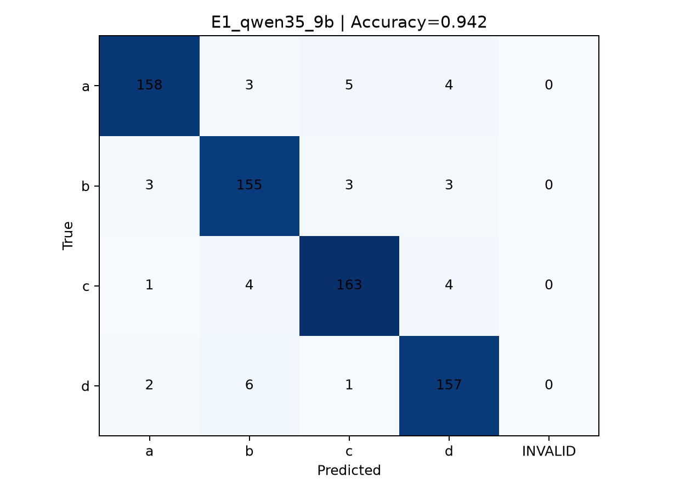

# AI Challenge 2 · 이미지 기반 4지선다 VQA

간판·메뉴판·표지판 사진과 질문, 선택지 `a`–`d`를 받아 정답 하나를 고르는 과제입니다.
이 저장소(개인 실험)의 최고 제출은 **Qwen3.5-27B + LoRA + Order4·Zoom(E8-A), Kaggle Public 0.97140**입니다.
E8 작업 당시 팀에서 받은 제출(Qwen3.6-27B, 0.97110)과 같은 추론 파이프라인을 3.5에 적용한 결과로, 모델 버전을 올리지 않고도 같은 수준에 도달했습니다.

> **팀 최종 성과:** Kaggle Public **0.97497**, **217개 참가팀 중 21위**.
> 위 0.97110은 E8 비교를 진행한 시점에 팀에서 받은 제출 기록이며, 팀은 이후 추가 제출로 0.97497을 달성했습니다.
> 이 저장소의 0.97140은 그 시점의 팀 제출과 비교한 개인 실험 결과이므로, 팀 최종 점수와 직접 비교하지 않습니다.

이 저장소의 초점은 점수보다 **무엇이 실제로 효과가 있었는지 가려내는 과정**입니다.
같은 평가 문항 위에서 한 번에 하나만 바꿔 비교했고, 정확도가 올라도 대응 표본 검정(McNemar)을 통과하지 못하면
개선으로 기록하지 않았습니다.

## 3분 요약

1. **OCR은 도움이 안 됐고, 모델 크기가 가장 확실한 지렛대였습니다.** 3B → 9B → 27B로 키울 때마다 올랐고(90.3% → 94.2% → 96.9%, val 672), 9B → 27B는 검정으로도 유의했습니다(p = 0.0014).
2. **프롬프트 기법은 9B에서 전부 효과를 확인하지 못했습니다.** CoT, 선지 감추고 먼저 읽기, 해상도, 위치 편향 네 가설 모두 "구분되지 않음"이었습니다.
3. **정답은 사진 속 사실이 아니라 교육생들의 합의입니다**(멘토 설명). 그래서 "라벨 오류"로 보이던 문항 상당수가 사실은 사람의 해석 방식(일반인 상식, 눈에 띄는 쪽, 맥락)이었습니다.
4. **지시문으로는 그 해석 방식이 전해지지 않았고, 학습으로는 전해졌습니다.** "사람들이 고를 답을 고르라"는 지시는 효과가 없었지만(p = 0.41), 9B에 QLoRA 학습만 더하자 +1.93%p(p = 0.011)가 올랐습니다.
5. **평가 기준을 바꿨습니다.** 고정 val 672는 LB보다 1.2%p 높게 나왔고, train 전체는 LB와 0.16%p 차이였습니다. 이제 학습 5,414 / holdout 1,300으로 나눠 holdout으로 판단합니다.
6. **마지막 한 걸음은 추론 단계에서 나왔습니다.** 27B LoRA에 팀의 Order4·Zoom을 그대로 옮기자 holdout 97.23%, **Kaggle 0.97140**으로, 3.6을 쓴 당시 팀 제출(0.97110)과 같은 수준이 됐습니다. 같은 문항에서 비교하면 3.5와 3.6은 구분되지 않았습니다.

## 결과 한눈에

| 단계 | 실험 | 바꾼 것 | 평가 세트 | 결과 | 판정 | 팀 ID |
| --- | --- | --- | --- | ---: | --- | --- |
| OCR | D | 이미지 없이 질문·선지만 (Qwen3.5-4B) | val 672 | 48.36% | 이미지 없이는 찍기에 가까움 | exp006 |
| | A | OCR 텍스트 → Qwen3.5-4B | val 672 | 68.90% | | exp003 |
| | C | 이미지 + OCR (Qwen2.5-VL-3B) | val 672 | 89.73% | B와 구분 안 됨(p = 0.557), 비용 5.3배 | exp005 |
| | B | 이미지만 (Qwen2.5-VL-3B) | val 672 | 90.33% | **OCR 없이 가기로** | exp004 |
| 모델 교체 | E1 | 3B → Qwen3.5-9B | val 672 | 94.20% | +3.87%p · **Kaggle 0.94727** | exp008·009 |
| 9B 한계 탐색 | E2 | E1 + CoT 지시 | val 672 | 95.09% | 구분 안 됨(p = 0.34), 비용 7.4배 | exp010 |
| | E3 | 선지 감추고 먼저 전사 → 대조 | val 672 | 94.20% | 구분 안 됨(p = 1.00) | exp012 |
| 모델 확대 | **E4** | 9B → **Qwen3.5-27B** | val 672 | **96.88%** | E1 대비 p = 0.0014 · **Kaggle 0.95710** | exp014·015 |
| 파인튜닝 | E5 | E1 + QLoRA (6,042문항) | val 672 | 96.13% | E1 대비 p = 0.011, E4와 구분 안 됨 | exp016 |
| 데이터 진단 | E6 | 27B 제로샷을 train 전체로 | train 6,714 | 95.87% | holdout 96.23%, **LB와 0.16%p 차이** | exp017 |
| | E6 | + "사람들이 고를 답" 지시문 | train 6,714 | 95.96% | 효과 없음(p = 0.41) | exp018 |
| | E6 | dev 5명 응답과 비교 | dev 2,683 | - | dev는 진짜 사람 응답 | exp019 |
| 파인튜닝 | **E7-A** | 27B + LoRA (학습 분할 5,414) | holdout 1,300 | **96.54%** | E6 대비 +0.31%p, 구분 안 됨(p = 0.62) · **Kaggle 0.96425** | exp020 |
| | E7-C | 27B + LoRA (+ dev 다수결, 7,440문항) | holdout 1,300 | 96.31% | E7-A 대비 8 : 11, 구분 안 됨(p = 0.65) → E8-C로 진행 | |
| 추론 기법 | E8-1 | E7-A + 선지 순서 4회 평균(Order4) | holdout 1,300 | 96.85% | E7-A 대비 9 : 5, p = 0.42 · **Kaggle 0.96723** | |
| | **E8-2** | E8-1 + 불확실 문항만 고해상도 재평가(Gate·Zoom·Blend) | holdout 1,300 | **97.23%** | E7-A 대비 14 : 5, p = 0.064 · **Kaggle 0.97140** | |

- 팀 ID는 팀 내부 실험 로그(비공개)의 실험 번호입니다.
- p값은 모두 같은 문항을 두 구성으로 푼 대응 표본의 McNemar exact 검정입니다. 정확도 두 개를 나란히 놓는 것보다 검정력이 높습니다.
- val 672는 로컬 RTX 5060 Ti에서 4bit(nf4), Kaggle 제출은 Colab A100에서 bf16으로 돌렸습니다. 두 조건의 결과가 같은 문항에서 98.8% 일치하는 것을 확인했습니다.

| D · 이미지 없이 질문·선지만 (48.4%) | E1 · 이미지 + Qwen3.5-9B (94.2%) |
| --- | --- |
|  |  |

왼쪽은 근거가 없을 때 모델이 `b`로 쏠려 찍는 모습입니다(정답 분포는 거의 균등). 쏠림은 정확도보다 예측 분포에서 먼저 보여서,
모든 실험에서 혼동 행렬에 INVALID 열과 예측 분포를 함께 남깁니다.

## 실험 흐름: 무엇을 묻고, 무엇을 알았고, 무엇을 바꿨나

### 1. OCR이 필요한가 → 아니다 (A·B·C·D)

- **질문:** 글자가 많은 사진이니 OCR로 글자를 뽑아 주면 도움이 되지 않을까?
- **실험:** OCR만(A), 이미지만(B), 이미지+OCR(C), 둘 다 없이(D)를 같은 672문항으로 비교했습니다.
- **결과:** 이미지+OCR(C 89.73%)이 이미지만(B 90.33%)을 넘지 못했습니다(p = 0.557). 두 구성이 갈린 26문항을 열어보니,
  정답 문구가 OCR에 담겨 있던 비율이 양쪽 모두 27%로 같았습니다. **OCR과 VLM이 같은 곳에서 실패합니다.**
- **그래서:** OCR을 접고 답변 모델을 키우는 쪽으로 갔습니다.

### 2. 모델을 키우면 → 오른다 (E1)

- 프롬프트·해상도·토큰 한도를 고정하고 모델만 3B → 9B로 바꿔 **94.20%(+3.87%p)**, Kaggle **0.94727**.

### 3. 9B에서 더 짜낼 수 있나 → 확인하지 못했다 (E2·E3)

- E1 오답 39건을 들여다보니, CoT로도 못 고친 22건 중 정답 문구가 추론문에 등장한 것은 5건뿐이었습니다. 실패가 추론이 아니라 **읽기(인지)** 에서 난다는 뜻이었습니다.
- 네 가지 가설을 세우고 모두 데이터로 확인했습니다.

  | 가설 | 결과 |
  | --- | --- |
  | 해상도가 부족하다 | ✗ 원본의 82%가 이미 긴 변 960 |
  | 선지 위치 편향이 있다 | ✗ 예측 분포가 정답 분포와 거의 같음 (전체 분포 기준. 문항별 순서 민감도는 이 방법으로 볼 수 없었고, E8 Order4에서 따로 다룸) |
  | CoT가 추론을 돕는다 (E2) | ✗ +0.89%p, p = 0.34, 비용 7.4배 |
  | 선지가 판독을 오염시킨다 (E3) | ✗ 11문항 고치고 11문항 망가뜨림, p = 1.00 |

- E3의 결정적 반증은 선지를 전혀 보여주지 않아도 간판의 `미술랭투스타`를 `미슐랭투스타`로 고쳐 읽은 것입니다. 교정은 선지 탓이 아니라 모델의 언어 습관이었습니다.
- **그래서:** 오답 39건을 원인별로 나눴습니다. 판독 11 · 위치 관계 6 · 추론 6 · 적힌 그대로가 정답 7 · 라벨 의심 3 · 복수 정답 6. 판독·위치 17건은 모델 용량 문제로 보고 27B로 갔습니다.

### 4. 27B로 키우면 → 처음으로 유의하게 오른다 (E4)

- 모델만 9B → 27B로 바꿔 **96.88%**. E1 대비 E4만 맞힌 24문항 / E1만 맞힌 6문항, **p = 0.0014**. CoT(E2)보다도 유의하게 좋습니다(p = 0.029).
- 예상과 달리 "적힌 그대로가 정답" 유형도 7건 중 6건을 고쳤습니다. 교정 습관은 언어 습관보다 **판독이 불확실할 때 흔한 표기로 기우는 현상**에 가까웠습니다.
- 16 GiB GPU에서 돌리려고 임베딩·lm_head만 CPU에서 계산했습니다(peak 12.5 GiB). 제출은 Colab A100에서 vLLM으로 22분 만에 끝났고 **Kaggle 0.95710**입니다.

### 5. 그런데 val이 LB보다 1.2%p 높다 → 평가 기준을 바꾼다

| | val 672 | Kaggle |
| --- | ---: | ---: |
| E1 (9B) | 94.20% | 0.94727 (+0.53%p) |
| E4 (27B) | 96.88% | 0.95710 (**−1.17%p**) |

672문항의 95% 신뢰구간이 ±1.3%p라 오차 범위 안이지만, 앞으로의 개선 폭이 대부분 1%p 안팎이라 판별이 어렵습니다.
train 전체(6,714)로 27B를 돌려 보니 **95.87%로 LB와 0.16%p 차이**였습니다. 그래서 train을 **학습 5,414 / holdout 1,300**으로 나눴고
(holdout에 기존 val 672 포함, `splits/e6_split.csv`), 이후 판단은 holdout으로 합니다.

### 6. 정답은 사람들의 합의다 → "라벨 오류"를 다시 본다 (E6)

멘토 설명: 정답은 교육생 여러 명이 같은 답을 고른 문항만 모은 것이고, 응답이 갈린 문항은 뺐습니다.
정답은 사진 속 사실이 아니라 **사람들이 기대하는 해석**입니다. 이 관점으로 보니 처음 분류가 달리 보였습니다.

| 문항 | 처음 판단 | 사람 합의로 보면 |
| --- | --- | --- |
| 그리스 문자 비석 → "라틴어" | 라벨 오류 | 로마자처럼 보이면 라틴어라는 일반인 상식 |
| GitHub·Microsoft 수건 → GitHub | 복수 정답 | 앞쪽의 흰 수건, 눈에 띄는 쪽 |
| 치즈 올린 전 → "김치전" (모델은 "치즈전") | 모델 오답 | 요리의 정체로 답하는 사람의 방식 |

E6에서 이를 데이터로 확인했습니다.

- **"사람들이 가장 많이 고를 답을 고르라"는 지시문은 효과가 없었습니다**(6,714문항 p = 0.41). 해석 방식은 말로 전해지지 않습니다.
- **dev.csv는 사람 5명의 원래 응답입니다.** 3표가 몰린 문항에서 모델 답의 득표율은 48.8%, 2표 문항에서 32.8%로, 사람 의견이 모일수록 모델도 따라갑니다(무작위면 약 25%).
- **모델이 확신하는데 사람과 다른 학습 문항 35개를 이미지로 전부 확인했습니다.**

  | 판정 | 문항 |
  | --- | ---: |
  | 결함 (선명한 글자와 정답이 어긋남, 전제가 틀림) | 13 |
  | 사람다운 해석 | 12 |
  | 애매함 | 5 |
  | **사람이 맞고 모델이 틀림** | 5 |

  모델이 확신하는 불일치를 기계적으로 빼면 22문항의 유용한 신호를 버리게 됩니다. 결함 13문항만 제외 후보로 두었습니다(`splits/e7_review_highconf.csv`).
- **오답은 모델이 망설이는 곳에 몰립니다.** 확신도 0.8 이하 6.7% 문항의 정확도가 61.9%이고, 오답의 62%가 여기 있습니다.

### 7. 학습으로 해석 방식을 가르친다 (E5 → E7)

- **E5:** 9B에 QLoRA 학습만 더했더니 **+1.93%p(p = 0.011)**. 파인튜닝만의 효과가 유의하게 나온 첫 결과이고, 3배 큰 27B 제로샷과 구분되지 않는 수준입니다.
- **E7:** 같은 방식으로 27B를 학습합니다. 학습 데이터 기준을 세 가지로 나눠 holdout 1,300에서 비교합니다.

  | 구성 | 학습 데이터 | 문항 |
  | --- | --- | ---: |
  | A | 학습 분할 전부 | 5,414 |
  | B | A − 결함 13 | 5,401 |
  | C | A + dev에서 5명 중 3표 이상 받은 다수결 | 7,440 |

  B는 A와 0.24%만 달라 효과를 가리기 어려워 A와 C를 먼저 봅니다.

- **E7-A 결과:** holdout **96.54%**로 27B 제로샷(96.23%)보다 +0.31%p지만, 갈린 36문항이 20 : 16이라 구분되지 않습니다(p = 0.62).
  val 672만 보면 오히려 −0.45%p입니다. 반면 **Kaggle은 0.96425로 +0.72%p**, 최고점을 갱신했습니다.
  두 평가의 방향은 같지만, Public LB의 비율을 모르니 LB만으로 유의성을 확정할 수 없습니다(Public 50%면 p ≈ 0.01, 30%면 p ≈ 0.08).
- **학습이 바꾼 것:** 갈린 문항의 절반 이상은 두 모델 모두 확신도 0.8 미만이던, 원래 망설이던 문항입니다.
  GitHub 수건(0.58 → 0.96)과 `미술랭투스타`처럼 사람다운 해석은 일부 배웠습니다. 그런데 선명한 간판의 `신웅타워`를 `신용타워`로,
  `상떼빌`을 `상테빌`로 고쳐 읽는 오답도 새로 생겼습니다. 확신도 0.8 이하 문항 비율은 6.3% → 6.2%로 거의 그대로입니다.
  (문항 목록은 대회 데이터라 공개본에서 뺐습니다.)
- **E7-C 결과:** dev 다수결을 더해 7,440문항으로 학습했더니 holdout **96.31%**(1252)로, E7-A(1255)와 갈린 19문항이 8 : 11이라 구분되지 않습니다(p = 0.65).
  27B 제로샷과도 17 : 16입니다. 결과를 보기 전에 정한 기준("E7-A보다 뚜렷하게 나쁘면(p < 0.1) E8-C를 돌리지 않음")에 걸리지 않아 E8-C로 갑니다.
  E8-A가 끝내 틀린 36문항 중 학습으로 고칠 수 있다고 본 15문항(사람 해석 12 · 왜곡된 전사 선지 3)에서 E7-C는 기본 순서 1회로 5문항을 맞혔습니다(E7-A는 2문항).
  문항 수가 작아 신호로만 보고, 판단은 E8-C 최종 holdout으로 합니다.

### 8. 학습 뒤에 추론 단계 기법을 더한다 (E8)

- **출발점:** 당시 팀 제출(Qwen3.6-27B + LoRA + Order4·Gate·Zoom·Blend, 0.97110)의 문항별 기록을 받아 같은 문항에서 비교했더니,
  3.5와 3.6은 제로샷(팀 검증 1,343에서 95.09% vs 94.64%, p = 0.46)과 LoRA(둘 다 학습에 안 쓴 257문항에서 243 vs 243)
  모두 구분되지 않았습니다. 반면 팀의 추론 기법은 LoRA 단독 대비 11 : 1(p = 0.006)이었습니다. 그래서 버전을 올리지 않고 3.5에 기법만 옮겼습니다.
- **기법:** 선지 순서를 `abcd·bcda·cdab·dabc`로 바꿔 4번 풀고 확률을 원래 선지로 되돌려 평균(Order4) →
  최댓값 < 0.85 · 1·2위 차이 < 0.25 · 순서별 답 불일치 중 하나면(Gate) 이미지를 147만~210만 픽셀로 키워 다시 Order4(Zoom) →
  기존 확률과 반씩 섞음(Blend). 팀 코드가 남긴 순서별 확률을 [src/tta.py](src/tta.py)에 넣어 1,343/1,343 같은 답이 나오는 것을 먼저 확인했습니다.
- **기준값은 고치지 않았습니다.** Gate·Blend 값은 팀이 자기 검증 1,343으로 정한 것이라, 그 세트에서의 p = 0.006은 낙관적일 수 있습니다.
  값을 그대로 두고 설정 선택에 한 번도 쓰지 않은 holdout 1,300에서 다시 잰 것이 E8입니다.

  | 단계 | holdout 1,300 | 직전 대비 (고침 : 망침) | Kaggle Public |
  | --- | ---: | :---: | ---: |
  | E7-A (LoRA) | 96.54% | | 0.96425 |
  | + Order4 | 96.85% | 9 : 5 (p = 0.42) | 0.96723 (+0.30%p) |
  | + Gate·Zoom·Blend | **97.23%** | 8 : 3 (p = 0.23) | **0.97140** (+0.42%p) |
  | E7-A → 최종 | | 14 : 5 (**p = 0.064**) | +0.72%p |

- **결과:** 단계마다 holdout과 LB가 같은 방향, 비슷한 크기로 올랐습니다. holdout만으로는 E7-A 대비 p = 0.064라 "개선"으로 적지 않지만,
  두 독립 표본의 방향이 일치합니다(Public이 test의 30%이고 갈린 문항이 고르게 섞였다면 LB 쪽 p ≈ 0.04). 27B 제로샷 대비로는 24 : 11(p = 0.041)입니다.
  test에서 그 팀 제출(0.97110)과는 117문항이 다르고 LB 차이는 +0.03%p라, **비교 대상이던 팀 제출과 같은 수준**으로 봅니다.
  (팀은 이후 추가 제출로 0.97497을 기록했으므로, 이 문장은 최종 성과가 아닌 당시 비교 대상에 대한 판단입니다.)
- **무엇이 고쳐졌나:** Order4는 E7-A가 확신하고 틀린 `신웅타워 → 신용타워`를 바로잡았습니다(순서 하나에서 생긴 교정 버릇이 평균으로 희석).
  Zoom은 주로 작은 글자(가격 500엔·6.95€·100g, 과태료 5만원, 층별 병원명)를 고쳤고, 위치·층수 문항 2개를 망쳤습니다.
  Gate 대상은 holdout 101문항(7.8%), test 525문항(7.8%)이었습니다.

## 배운 것

- **한 번에 하나만 바꾸고, 대응 표본으로 검정한다.** 0.9%p 향상(CoT)도 672문항에서는 우연과 구분되지 않았습니다.
- **평가 세트의 크기가 판단의 한계를 정한다.** val 672로는 ±1.3%p를 가릴 수 없었고, 그 사이에 LB와 1.2%p 차이가 났습니다.
- **"라벨 오류"는 정답의 정의를 확인한 뒤에 말한다.** 이 대회에서 정답은 사람 합의라, 오류처럼 보이던 문항이 배워야 할 신호였습니다.
- **모델이 확신하는 불일치도 모델이 틀린 경우가 있다.** 데이터를 거를 때는 이미지로 직접 확인했습니다.
- **모델을 바꾸기 전에 같은 문항에서 비교한다.** 3.6이 최종 모델이었지만 문항 단위로 맞대 보니 3.5와 구분되지 않았고, 점수 차이는 추론 기법에서 나왔습니다.
- **로컬 4bit와 Colab bf16은 같은 결과를 낸다.** 검증은 로컬 4bit로, 제출은 Colab vLLM bf16으로 나눠도 됩니다(일치율 98.8%).

## 다음 단계

1. E7-C 위에 E8 파이프라인을 얹은 E8-C를 Colab에서 실행하고, 최종 holdout이 E8-A(97.23%)보다 낮지 않으면 test 제출 (낮으면 E8-A 0.97140 유지)
2. (보류) 학습 때 선지 순서를 섞은 LoRA(A′). 순서 불일치가 2.8%이고 Order4가 이미 처리해서 우선순위를 낮춤

## 실험을 어떻게 재는가

- **분할 고정:** 모든 실험이 같은 CSV를 읽고 ID 해시를 대조합니다. 라이브러리 버전이 바뀌어도 분할이 다시 추첨되지 않습니다.
- **프롬프트·파서 공유:** 노트북이 코드를 복사하지 않고 [src/common_eval.py](src/common_eval.py)를 import합니다. 복사본은 조용히 어긋나서 비교를 무너뜨립니다.
- **INVALID를 숨기지 않음:** 초기 베이스라인은 파싱 실패를 `a`로 메워 예측의 42%가 `a`가 됐습니다. 지금은 a~d 확률로 채우고, INVALID 수와 예측 분포를 함께 기록합니다.
- **학습과 추론의 입력을 토큰 단위로 맞춤:** QLoRA 학습 입력은 추론 프롬프트 뒤에 정답 글자만 붙인 것이고, 손실도 그 글자에만 겁니다.

## 엔지니어링

- **16 GiB에 27B 올리기:** 4bit로 양자화하고 임베딩·lm_head(합쳐 5 GiB)만 CPU에서 직접 계산합니다. 기본 오프로딩은 매번 가중치를 GPU로 복사해 3배 느렸습니다.
- **Colab vLLM 제출:** 27B bf16으로 test 6,714문항을 22분에 풉니다(로컬 4bit는 약 3.8시간). test 전에 같은 val을 먼저 풀어 로컬 결과와 맞댑니다.
- **Colab 노트북이 코드를 품는다:** Colab은 비공개 저장소를 clone할 수 없어, 노트북 생성 시 `src/` 원문과 분할 목록을 노트북 안에 넣습니다. Drive에 코드 사본을 둘 필요가 없고 버전이 어긋날 수도 없습니다.
- **끊겨도 이어서:** 추론은 문항 묶음마다, 학습은 20스텝마다 Drive에 저장하고 다시 실행하면 이어 갑니다.
- **GPU 없이 먼저 검증:** 노트북은 생성 스크립트로 만들고, 가짜 vLLM이나 작은 모델(4B)로 전 과정을 먼저 돌린 뒤 비싼 실행을 합니다.

## 저장소 구조

```text
notebooks/experiments/  A~E8 실험·제출 노트북 (scripts/build_*.py로 생성)
src/                    공통 코드: 분할·프롬프트·파서(common_eval), VLM 적재·추론(vlm_runtime),
                        QLoRA(qlora), Colab vLLM 추론(vllm_eval), Order4·Gate·Zoom(tta), OCR 모듈
scripts/                노트북 생성기, 분할·학습 구성 도구, 실행·다운로드·비교 도구
splits/                 평가 분할(학습 5,414 / holdout 1,300), 학습 구성 A·B·C, 35문항 검토표
docs/                   실험 상세, 의사결정 이력, 트러블슈팅, 실행 방법
tests/                  단위 테스트 18건 + 노트북 검증 (GPU 불필요)
assets/                 README 그림
```

데이터(`data/`), 모델(`downloads/`), 실험 결과(`output/`)는 대회 데이터 문항·예측이 들어 있어 이 공개본에 넣지 않았습니다.
코드·분할 ID·문서만 공개합니다.

## 실행

```bash
# 테스트 (GPU·모델 불필요)
pip install -r requirements.txt
python -m unittest discover -s tests -v

# 로컬 실험: 노트북 전체 실행, 또는 특정 절부터 (예: 제출 추론만)
python scripts/run_nb.py notebooks/experiments/AI_Challenge2_expE4_qwen35_27b.ipynb
python scripts/run_nb.py notebooks/experiments/AI_Challenge2_expE4_qwen35_27b.ipynb --from "제출 추론"

# 노트북 다시 생성 (노트북을 직접 고치지 말고 생성기를 고친 뒤 다시 생성)
python scripts/build_e7_colab_notebook.py A
```

Colab 노트북(`*_colab.ipynb`)은 Colab에서 열고, 설치 셀 실행 → 세션 다시 시작 → 나머지 순서로 돌립니다.
데이터 배치와 세부 절차는 [docs/setup.md](docs/setup.md)에 있습니다.

## 문서

| 문서 | 내용 |
| --- | --- |
| [docs/experiments.md](docs/experiments.md) | 실험별 설계·수치·검정, 오답 분류, 데이터 진단 |
| [docs/decisions.md](docs/decisions.md) | 날짜별 진행 이력, 선택의 근거, 남은 작업 |
| [docs/troubleshooting.md](docs/troubleshooting.md) | 실제로 막힌 문제와 해결 |
| [docs/setup.md](docs/setup.md) | 환경 준비, 실행, 제출 파일 생성 |


## 기록 원칙

관찰하지 않은 성능 향상이나 완료 여부는 추정해서 적지 않습니다. 측정하지 못한 항목은 "실측 필요"로 남깁니다.
정확도 차이가 검정을 통과하지 못하면 "개선"이 아니라 "현재 표본에서 구분되지 않음"으로 적습니다.
